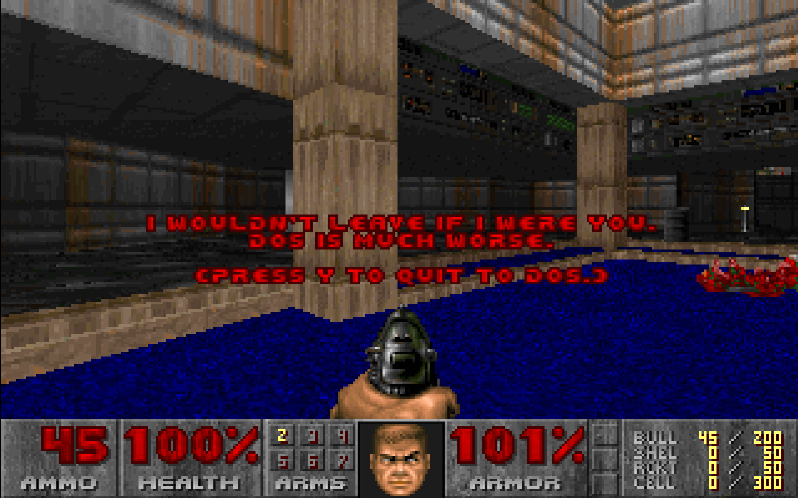

# ROOTDoom

Doom with 3D graphics rendered through [CERN ROOT](https://root.cern/).
The real [doomgeneric](https://github.com/ozkl/doomgeneric/tree/e257a09527062bfb986b6e5e0780839b6cbd5b71) engine runs the game
simulation while ROOT's embedded OpenGL viewer draws textured levels, moving
sectors, sprites and weapons. ROOT also handles the window and keyboard input.

The game and interpreter share one ROOT process; the prompt remains usable
while Doom runs.



## Build and play

Requires Git, CMake 3.24+, GCC or Clang with C++17 support, and ROOT 6 with
GUI, ASImage and OpenGL (RGL) support, on either:

- **Linux** with X11/GLX. Verified with ROOT 6.40.04 and GCC 13.3 on an
  Ubuntu 24.04 base.
- **macOS** with a ROOT built for the native Cocoa backend, ROOT's macOS
  default (`root-config --has-cocoa` prints `yes`). No X11/XQuartz is needed. Verified with
  Homebrew ROOT 6.40.04 and Apple Clang 21 on macOS 27 (Apple silicon).

If you need ROOT, follow its [installation instructions](https://root.cern/install/)
and choose a build matching your platform and compiler. On macOS,
`brew install root cmake` provides both; Xcode's Command Line Tools
(`xcode-select --install`) provide Git and the compiler.

### 1. Get the source

Run these commands in a desktop terminal: on Linux, one with access to your
X11 display; on macOS, any Terminal window in your logged-in session.

```sh
git clone https://github.com/MohamedElashri/ROOTDoom.git
cd ROOTDoom
```

### 2. Activate ROOT

For a ROOT binary installation, replace `/path/to/root` with its installation
directory. Keep using this terminal for the remaining steps.

```sh
source /path/to/root/bin/thisroot.sh
root-config --version
```

If ROOT is supplied by an activated package environment, use that environment's
setup instead. Homebrew's ROOT is already on your PATH and needs no setup.
`root` and `root-config` should both be available on your PATH. To check ROOT
and the native display before building, run `./scripts/check-environment.sh`.

### 3. Prepare the game data

Supply your own Doom IWAD. Shareware `doom1.wad` can be extracted from the
original [Doom95 archive](https://www.gamers.org/pub/idgames/idstuff/doom/win95/).
Keep the file anywhere on your machine and use its absolute path in the launch
commands below, replacing `/absolute/path/to/doom1.wad`. Game data is not
bundled or downloaded automatically.

### 4. Build

From the `ROOTDoom` directory, configure and compile:

```sh
cmake -S . -B build -DCMAKE_BUILD_TYPE=Release
cmake --build build --parallel
```

The first configure downloads the pinned doomgeneric sources and requires
internet access. The build produces `build/rootdoom` and the shared library
`build/librootdoom.so` (`build/librootdoom.dylib` on macOS).

### 5. Launch and play

```sh
./build/rootdoom --iwad /absolute/path/to/doom1.wad
```

Click the canvas to focus it, then use **Enter** to select **New Game** and
continue through the game setup. **Arrows** move/turn, **Ctrl** fires, **Space**
opens doors, **Shift** runs, **Enter** selects and **Escape** opens the menu.
On macOS, fire with **Control**, not Command.
Close the window or quit through Doom's menu to stop.

Configuration and saves go in `rootdoom-data/` under the current directory;
add `--data-dir DIR` to choose another location.

The default `rootgl` backend replaces Doom's software world-rendering pass;
the original menus, HUD and automap are retained. Add `--wireframe` to inspect
the geometry, or `--renderer classic` for the original software-rendered view.
Lighting, palette and invisibility effects in `rootgl` are approximations.
Sound is disabled.

## Run inside ROOT

After completing steps 1–4, you can launch the game from a ROOT prompt instead.
From the project directory, in the terminal where ROOT is activated, run:

```sh
root -l
```

At the `root [0]` prompt, load the macro with your IWAD's absolute path:

```cpp
.x macros/doom.C("/absolute/path/to/doom1.wad")
```

The default geometry renderer runs in the same ROOT process and leaves the
prompt usable: enter `1+1` to try it. Close the game window, then enter `.q`
at the ROOT prompt to exit ROOT. Restart ROOT before another game.
To select the classic backend, pass `"classic"` as the third argument;
the optional second argument is the data directory. The macro finds the
library in `build/`; for a custom build, set `ROOTDOOM_LIBRARY` to the absolute
path of `librootdoom.so` (`librootdoom.dylib` on macOS).

## How it works

A Doom level makes an unusual ROOT scene: doors rise, monsters move, and the
camera follows the player through the map. ROOTDoom gives ROOT that changing
world to draw while the real Doom engine keeps running underneath. Collision
detection, enemy AI and the rules of the game still belong to doomgeneric.
The experiment is in how that world reaches the screen.

Doom's maps provide the starting point. Their binary space partitioning (BSP)
trees divide the level into regions that can be turned into floor and ceiling
polygons. [GeometryExport.cpp](src/GeometryExport.cpp) clips those regions,
triangulates them, and builds the walls from sector boundaries. An opening
door illustrates the connection: Doom updates the sector's ceiling height,
and the next exported scene contains wall spans at the new height. ROOT draws
the motion produced by the game simulation.

The familiar appearance comes from the same IWAD that supplies the level.
[GeometryAssets.cpp](src/GeometryAssets.cpp) decodes its palette, wall texture
definitions, patches and floor/ceiling images into cached RGBA textures.
Monsters and objects become textured quads facing the camera, preserving
Doom's sprite artwork inside the 3D scene. The weapon is drawn separately in
screen space so it stays in front of the player as the camera turns.

That scene enters ROOT through
[RootGeometryPresenter.cpp](src/RootGeometryPresenter.cpp). A custom
`TGLSceneBase` calls [GeometryGL.cpp](src/GeometryGL.cpp) inside an embedded
`TGLViewer`. ROOT owns the window, OpenGL context and event loop: on Linux the
viewer renders through ROOT's GLX read-back device, and on macOS into Cocoa's
on-screen OpenGL view at Retina resolution. The project's drawing code
supplies the projection, texture handling, depth testing and compositing. The level is represented by triangle batches, rather than `TGeo`
volumes. Try `--wireframe` to see the surfaces behind the textured corridors.

During normal play, a host hook skips Doom's software world renderer just
after camera setup. The original HUD remains an image composited over the
ROOT scene, while menus, pause screens and the automap use the original
software frame. This keeps those interfaces intact while the level itself
passes through the geometry renderer. Selecting `--renderer classic` sends
the software framebuffer to a `TASImage` instead.

Keeping the game and the ROOT prompt responsive requires a boundary between
them. Doom runs on a worker thread and publishes immutable `GeometryFrame`
snapshots containing owned vertices and shared textures. A mailbox holds only
the latest pending scene, so a slow redraw cannot build a queue of stale
frames. The GUI never follows pointers into the running engine. Its ROOT timer
targets 30 FPS independently of Doom's simulation clock, while a bounded input
queue carries keyboard events back to the game. Losing focus releases held
keys, so switching windows does not leave the player running into a wall.

[Runtime.cpp](src/Runtime.cpp) brings these pieces together and handles the
session's lifetime. Closing the canvas requests a stop, joins the worker and
releases engine and graphics resources; the hosting ROOT process stays alive.
The upstream engine retains global state, so another game requires a fresh
process. The adapter and worker live in `src/DoomPlatformAdapter.cpp` and
`src/DoomRunner.cpp`, with shared interfaces and queues under
`include/rootdoom/`. CMake generates the host hooks in the build directory and
hides private engine symbols to avoid collisions with ROOT's loaded libraries.
The `macros/` and `scripts/` directories provide entry points, and `tests/`
checks geometry, captured pixels, input and shutdown across both backends.

## License

ROOTDoom is [GPL-2.0-or-later](LICENSE). doomgeneric retains its original
copyright and license notices; ROOT is an external dependency with its own
license. Doom game data is separately copyrighted and is not included.
